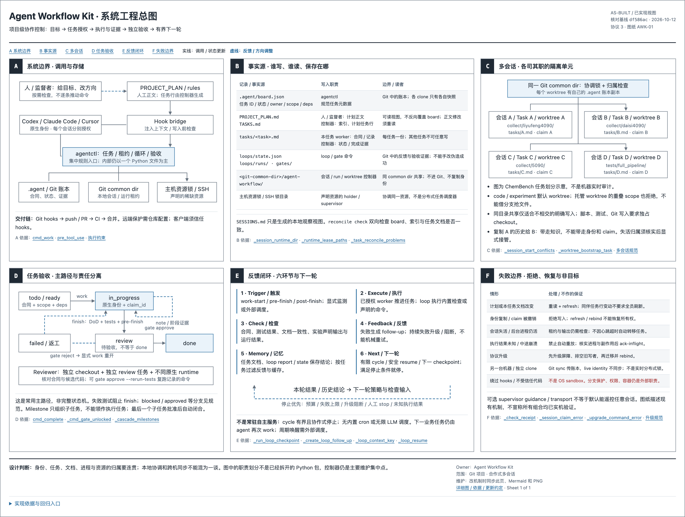
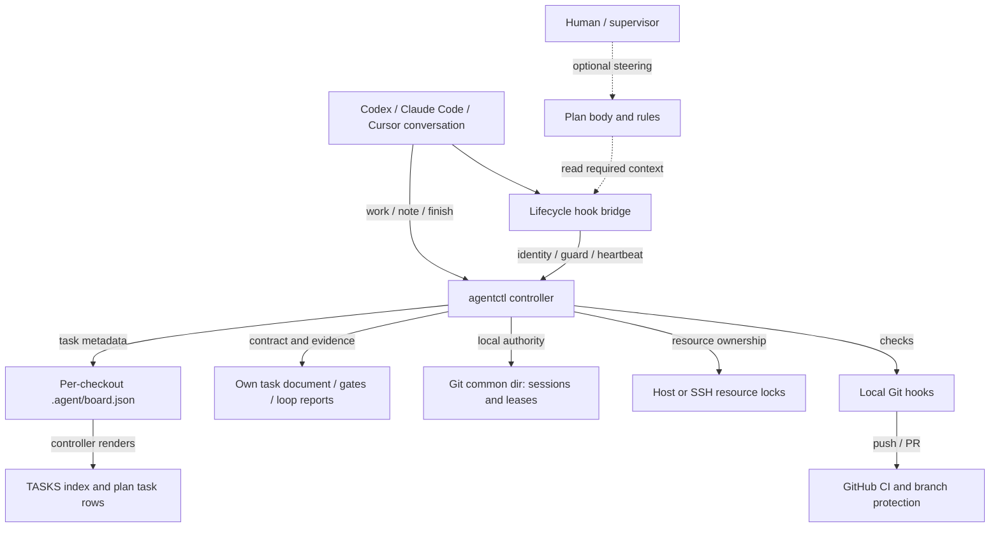
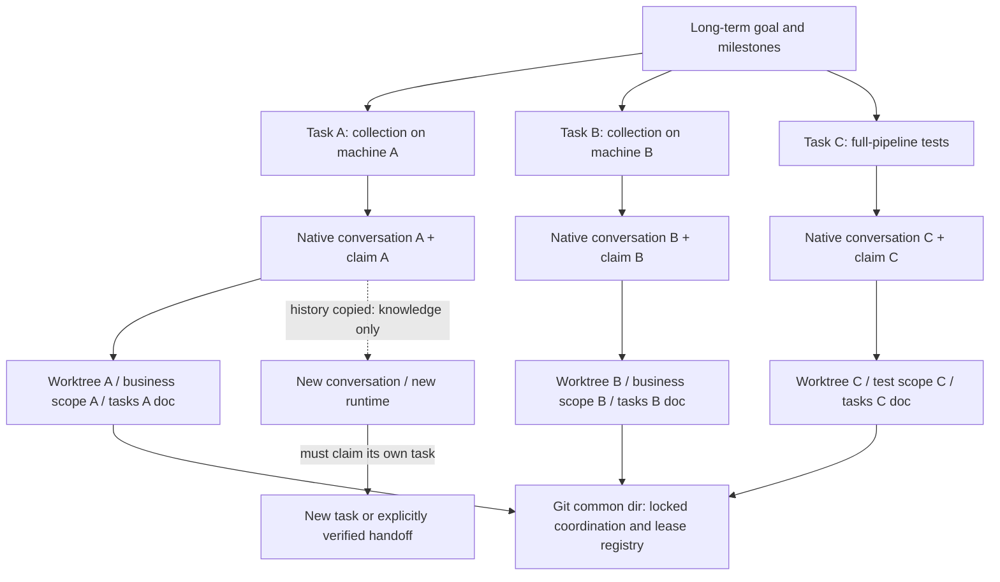
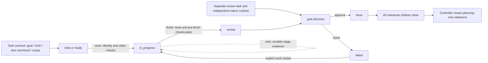
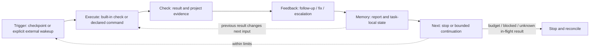

# Architecture Drawings

The drawings explain the **implemented** organization, not a proposed agent
platform. Source reviewed: `df586ac` (2026-10-12), protocol 3. Logical areas below
are responsibilities inside the existing controller, not independent services
or already-separated Python packages. This change adds no runtime mechanism.



Open [the offline engineering sheet](system-sheet.html) in a browser for readable
text, source links, collapsible evidence, and A3 landscape printing. GitHub shows
the PNG above and the editable Mermaid diagrams below; it does not execute HTML
in the file viewer. The Chinese sheet follows six panels:

- A: system boundary and calls.
- B: canonical state, writers, and storage boundaries.
- C: multiple conversations and copied-history isolation.
- D: task delivery and independent acceptance.
- E: Trigger, Execute, Check, Feedback, Memory, Next.
- F: refusal, recovery, and guarantees the kit does **not** make.

## 1. System Context And State Ownership



`board.json` is canonical for ID, status, owner, scope, type and dependencies.
Task documents own contracts and narrative evidence. The human plan body is not
a generated board. `TASKS.md` and plan task rows are projections, not competing
task authorities. `reconcile check` detects inconsistencies in both directions.
`SESSIONS.md` is a local observation view, not a durable identity registry.

Local runtime records live under `<git-common-dir>/agent-workflow/` for Git
projects. This shares live ownership among **linked worktrees**, not among
independent clones or machines. Every checkout has its own committed `.agent`
snapshot. Git sync/merge-back carries task ledger changes; it does not carry
live identities, resources, processes, or candidate code by implication.

Source: `cmd_work`, `_session_runtime_dir`, `_runtime_lease_paths`,
`_task_reconcile_problems`, `_update_plan_task` in
[agentctl.py](../../tools/agentctl.py); `session_start`, `pre_tool_use` in
[the hook bridge](../../tools/agent_workflow_hook.py).

## 2. Task And Conversation Organization



Code and experiment tasks default to managed worktrees. Managed leases reject
overlapping write scopes even across their worktrees. Same-task claims are
refused across all linked worktrees. Shared-checkout tasks need disjoint scopes;
opaque scripts, tests and Git mutations require an exclusive checkout. A scope
must include the worker's implementation **and tests/declared outputs**.

Each worker updates its own task document with `note`/`finish`; controller
commands update only the relevant board/index/plan rows. Peer row churn does
not invalidate other workers' receipts. Changed plan prose, rules or own task
instructions require re-reading and `refresh`. `refresh` and `upgrade rebind`
acknowledge instructions/epoch, never confer ownership on a revoked claim.

The ChemBench labels in panel C illustrate a possible scope split, **not** a
live audit or a claim that four machines share a realtime coordinator. A full
test must declare every output; if it changes common code, serialize or split
that write from the collection tasks. Coordinate actual GPUs through declared
resource leases; independent remote task ledgers synchronize through Git.

Source: `_session_start_conflicts`, `_worktree_bootstrap_task`,
`_session_claim_error`, `_check_receipt`; see
[multi-session execution](../multi-session-execution.md) and
[worktree merge-back](../worktree-merge-back.md).

## 3. Delivery And Independent Acceptance

This is the **usual path**, not the entire status transition graph. The vocabulary
also includes `blocked` and `approved`.



The reviewer inspects the **actual frozen candidate code**, not just an imported
ledger. A separate checkout and native runtime prevents the worker approving
itself. `gate approve --rerun-tests` reruns the recorded test command; the option
is available, not silently mandatory for every approval. Worker `finish` cannot
turn failing tests into a review-ready result. An independent gate still needs
semantic evidence; exit 0 alone is not proof of the user's goal.

Milestones are planning-only and cannot be claimed as execution tasks. Subtasks
have separate contracts, scopes and acceptance. Task `done` is not itself proof
that a PR merged or that remote CI passed; verify the exact remote commit.

Source: `cmd_complete`, `_cmd_gate_unlocked`, `_cascade_milestones`; see
[task contracts](../../tests/test_task_contract.py) and
[milestone regressions](../../tests/test_milestones.py).

## 4. The Six-Part Bounded Loop



Business work is performed by the authorized agent. Checkpoint loops inspect it
or run declared commands: they are not a hidden unlimited LLM scheduler.
`work-start`, strict `pre-finish`, and `post-finish` trigger automatically at their
lifecycle boundaries; experiment checks are explicit. Finite `loop cycle`
supports cooperative stopping and safe resume. A new business task needs the
agent to run `work` again; recurrent wakeup needs an external scheduler. There
is no installed cron service or background scheduling daemon.

Feedback, previous outcomes and cache keys are task-filtered. Reports and state
persist outside chat; repeated failures escalate instead of burning retries.
An unknown in-flight result blocks replay: inspect process and side effects,
then explicitly reconcile. Recovery is not rollback of command side effects.

Source: `_run_loop_checkpoint`, `_create_loop_follow_up`, `_loop_context_key`,
`_loop_resume`; see [loop states and stop conditions](../loop-engineering.md).

## Design Assessment And Limits

The useful design property is a connected ownership chain:
**native runtime → claim → task/scope → run/output/resource → evidence → gate**.
Its durable state and local authority are deliberately different. This lets
agents share a plan without sharing mutable task authority.

The principal maintenance concentration is the large `agentctl.py`, not a set
of separately deployable modules. Diagrams improve inspectability; they do not
solve that concentration or establish universal correctness. Tests referenced
in the sheet cover specific failures and boundaries, not every possible host,
tool or project combination.

Cooperative hooks are **not an OS sandbox**; untrusted programs need external
permissions/container isolation. Client hook trust and GitHub branch protection
remain external setup. GPU/resource leases are not a distributed workload
scheduler. Optional guidance transports are not default remote control of any
named Fable/Codex session. Protocol upgrades drain old writers before new-epoch
work; they do not revive revoked ownership.

## Drawing Maintenance

The source of truth is code and workflow contracts, not this visualization.
When one of the mapped mechanisms changes, review the relevant panel and
Mermaid diagram in the **same PR**, update the reviewed baseline/date, and
regenerate the PNG from the HTML. Do not invent a second architecture-state
database or use diagrams to drive authorization.

The HTML is self-contained and network-free. Capture its `main` element in a
browser at a 2000-pixel viewport after fonts load; the checked-in PNG is that
desktop projection. On mobile, panels stack and wide diagrams scroll within
their own viewport. Print uses A3 landscape. Source links use files and named
symbols rather than line numbers that shift on every edit.

`python3 -m unittest tests.test_architecture_docs -v` checks panel/loop structure,
offline file links and Python AST symbol references; existing Linux CI discovers
it automatically. A renamed/deleted reference fails the check. A changed
implementation with the same symbol name still needs **semantic source review**.
The tests do not verify pixels, PNG freshness or runtime guarantees. Browser
screenshots and source review supply those separate acceptance checks.

Rendering dependencies are not installed into target projects. To refresh the
PNG with an available Playwright installation, use the CLI from the kit root:

```bash
npx playwright screenshot --browser chromium --viewport-size '2000,1400' \
  --full-page "file://$PWD/docs/architecture/system-sheet.html" /tmp/awk-sheet-page.png
```

This CLI captures the whole page; for the committed sheet, crop to `main` via
Playwright's element screenshot API. Do not change runtime dependencies merely
to render documentation. After capture, verify desktop and narrow viewport
text/diagram fit and retain the evidence in the task record.
