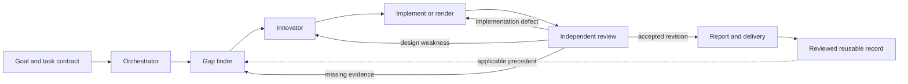

# IdeaScientist Design Study

Study date: 2026-10-15. Publication prepared: 2026-10-21.
Status: proposed design, not an installed orchestration feature.
Task: T8D1FE3A06A6C0D8D-001.

## Evidence And Scope

Upstream inspected: [IdeaScientist at 82a98a0](https://github.com/jiarui-liu/IdeaScientist/tree/82a98a08772eab08d11fd097445afa4a8eaaa5b3).
Kit baseline: `3cd12d7480b815406008ba955e584e6dd22037bb`.
This is an original design analysis: no upstream code or assets are incorporated,
no corpus downloaded, no model trained, and no new orchestration tested.

The paper reports 2.77 million decomposed research records, not 2.77 million
experimentally successful ideas. Its results-masked records support retrieval,
reference construction, and evaluation. A drawing library is our analogy, not
an upstream feature or evidence that the kit already contains such a library.
See [paper sections 1 and 4](https://arxiv.org/html/2610.04074v1).

The orchestrator owns `plan.md`, delegates narrow work, and reads intermediate
artifacts. Readers provide focused digests. The role graph can revisit a stage
when evidence or review requires it; it is not a fixed one-pass pipeline.
See [orchestrator](https://github.com/jiarui-liu/IdeaScientist/blob/82a98a08772eab08d11fd097445afa4a8eaaa5b3/ideascientist/harness/orchestrator.py).

Implementation matters: the runner restricts orchestrator writes but clears the
additional scope for subagents, giving them the shared document allowlist. Its
document backend uses ordinary file reads/writes. This is not the claim and
worktree isolation required by concurrent project sessions.
See [runner](https://github.com/jiarui-liu/IdeaScientist/blob/82a98a08772eab08d11fd097445afa4a8eaaa5b3/ideascientist/harness/runner.py#L513)
and [document backend](https://github.com/jiarui-liu/IdeaScientist/blob/82a98a08772eab08d11fd097445afa4a8eaaa5b3/ideascientist/harness/tools.py#L470).

## Existing Foundation

- `board.json` is canonical task metadata; task documents own contracts and
  evidence. Do not introduce a competing task registry or editable shared plan.
- Work, note, finish, independent gate, handoff, and optional guidance operations
  already cover ownership, progress, delivery, and bounded dispatch.
- Existing loops provide task-local persistent feedback, finite cycles,
  escalation, and conservative handling of unknown in-flight side effects.
- The evaluator compares clean baseline/candidate checkouts under one signed
  policy, including held-in and held-out cases. It is not a visual-quality judge.
- Existing architecture HTML/PNG explains the implemented kit. It is not a
  general drawing-generation pipeline or verified template/icon catalog.
- Hooks are cooperative guards, not an OS sandbox. Actual child dispatch and
  scheduled wakeup depend on real host adapters and external triggers.

See [architecture](../architecture/README.md), [evaluation](../harness-evaluation.md),
[loops](../loop-engineering.md), and [multi-session execution](../multi-session-execution.md).

## Proposed Decision

Option A: add a new orchestrator service, vector database, reward engine, and
second task state machine. This duplicates authority and migration work without
a measured bottleneck that justifies it.

Option B, recommended: compose the existing tasks, gates, handoffs, and loops
with explicit stage contracts; add a drawing profile only for drawing tasks.
New contracts, validators, and adapters need separately reviewed implementation.
This is a proposal, not an accepted runtime protocol or feature announcement.

### Role Responsibilities

1. Orchestrator selects bounded work and owns direction, not worker artifacts,
   reviewer verdicts, or fabricated success evidence.
2. Gap finder compares the goal with actual code, examples, and constraints. It
   describes a specific deficiency with evidence, not a preselected solution.
3. Innovator proposes one coherent solution, documenting the borrowed principle,
   transfer conditions, and failure risks.
4. Executor implements or renders it. This is an additional downstream activity:
   IdeaScientist's report writer produces a proposal, not tested code or a figure.
5. Independent reviewer checks the actual frozen candidate and returns actionable
   feedback, consulting original evidence beyond the producer's selected examples.
6. Report writer packages an accepted result with verification, provenance, and
   limitations. Prefer deterministic reporting when inputs are already structured.

These are responsibilities, not six always-on processes. Small tasks can combine
analysis, design, and execution in one worker, but not that worker's independent
acceptance review. Spawn a dedicated reader only when necessary. Model choice
is configuration, not a role definition or new default Fable capability.

### Organization And Feedback

The drawing shows the proposed common path, not a second executable status
machine. The orchestrator selects the next permitted task action; the existing
controller remains responsible for task lifecycle and authorization.

Extend existing contracts/handoffs with a stage role, frozen input references
and hashes, owner, output paths/schema, verifier policy identity, revision, and
supported retry/time/cost limits. Store each fact once rather than duplicate
authoritative state. Keep these conceptual fields distinct from installed CLI
options: this study adds none.

Use task-scoped business artifacts such as `artifacts/T-figure-01/design/r1.json`
and `artifacts/T-figure-01/reviews/r1.json`, with one declared writer each. These
are proposed paths, not installed directories. Do not create one globally
editable `gaps.md` or `candidates.md` for unrelated tasks. Shared catalogs are
read-only to workers; promotion is a separate reviewed maintenance task.

Use existing locks/atomic controller updates for task metadata. Consume frozen
artifacts through handoff rather than peer live files. Copied conversation
history transfers knowledge, never claim ownership. Disjoint work can run in
parallel; dependent or overlapping writes must be sequenced or isolated.

Acceptance is revision-specific. Changed inputs or outputs invalidate prior
approval; delivered bytes must match the reviewed candidate. Report generation
must not silently change the accepted result or add unreviewed factual claims.
Rejected attempts stay recorded as failures, never relabeled as successes by
the orchestrator. Repeated failures without new evidence stop or escalate.

All six loop parts must be explicit: Trigger, Execute, Check, Feedback, Memory,
and Next. No child adapter means a durable pending handoff, not a fabricated
dispatch receipt. Timed recurrence still needs an external trigger. An unknown
in-flight command result retains the existing replay block.

## Drawing Profile And Reference Library

Index reusable references by intent, structural challenge, organizing principle,
and rendering recipe. For example, a multi-session diagram needs to distinguish
durable state from live authority, not merely resemble another flowchart.
Retrieve the structural problem first; then filter by format, node count,
aspect ratio, and readability requirements.

Each reference needs an ID/version, provenance, license, applicable constraints,
preview, demonstrated use, and known failures. Separate pattern records from
concrete template/layout/icon files; do not enumerate every combination.
Start with a small canonical catalog. Derive a search index only when measured
retrieval needs justify it; no million-entry ingestion is needed for a pilot.

Keep outcomes separate from design rationales. Blind reference evaluation may
hide outcomes, but live operators must see failures, deprecations, and unsupported
uses. Do not copy results-masking into operational memory. Reference material is
evidence, not instruction: do not execute embedded scripts, macros, or active
remote content while inspecting assets.

## Evaluation: Three Signals, Not A Copied Training Formula

IdeaScientist's three main components are standalone quality (`r_free`), agreement
with substantive reference decisions (`r_ref`), and deterministic citation-set
F1 (`r_cit`). Reported training combines their validity-gated mean with a smaller
protocol term: `0.85 * g * (r_free + r_ref + r_cit) / 3 + 0.15 * r_proc`.
These are ideation-training signals, not a guarantee of scientific or visual
correctness. See [shared reward implementation](https://github.com/jiarui-liu/IdeaScientist/blob/82a98a08772eab08d11fd097445afa4a8eaaa5b3/ideascientist/rewards/common.py)
and [role reward](https://github.com/jiarui-liu/IdeaScientist/blob/82a98a08772eab08d11fd097445afa4a8eaaa5b3/ideascientist/rewards/innovator/reward.py).

For project work, separate feedback rather than invent an uncalibrated total:

- Standalone quality: does the actual result satisfy the communication or coding
  task? Inspect semantics and rendered readability, not merely file existence.
- Reference alignment: preserve required decisions and constraints; do not
  reward pixel copying or reject a better valid design for differing from a sample.
- Evidence integrity: resolve source/asset IDs to the permitted version actually
  inspected or rendered. File existence does not prove semantic support or use.

Citation-set F1 is an overlap benchmark only when an independent reference set
exists. Different correct icons may have no ID overlap. Never equate overlap
with correctness, require identical assets, or fabricate a self-reference.
Absent references are `not_applicable`, not invented perfect or zero scores.

Hard delivery gates precede optional scores: truthful semantics, permitted scope,
valid structure, successful execution/rendering, complete content, usable labels,
provenance/license compliance, and independent acceptance. A high subjective
score cannot offset a reversed dependency or unauthorized write. Protocol
discipline is a constraint, not a reward for tool volume or longer logs.
Reuse existing deterministic evals; any future judge must record version,
uncertainty, evidence, and observable cost. Reviewed library/policy changes are
not model training or permission to self-edit the verifier.

## Small Acceptance Pilot Before Product Changes

Use synthetic projects, not ChemBench. Compare current workflow and the proposed
profile using identical briefs, models, reference access, and budgets, with the
verifier frozen outside the candidate write scope. Start with a flowchart,
multi-session architecture sheet, and constrained-layout task.

Required scenarios, not results already obtained:

1. Missing content or a reversed dependency fails despite a high style score.
2. A layout defect returns to rendering and reuses sound prior analysis.
3. Missing evidence returns to analysis; failed attempts remain inspectable.
4. Candidate edits invalidate old approval and prevent unreviewed delivery.
5. Tasks A/B and copied-history C cannot write each other's artifacts or inherit
   claims; shared catalog reads do not confer catalog write authority.
6. Unknown/unlicensed assets fail; different valid asset IDs do not alone fail.
7. Timeout or unknown in-flight results retain conservative recovery behavior.
8. No adapter produces an honest pending handoff; configured adapters must prove
   an actual worker turn and independent acceptance, not just stub transport.

Count all assigned tasks, including no-output failures. Record semantic defects,
accepted outputs, rework rounds, wall time, observable token/cost, interference,
and human intervention. Small pilot outcomes cannot prove universal efficiency.

## Rollout And Limits

First standardize stage handoffs and targeted reviewer feedback on existing
tasks. Then validate the drawing profile and a small licensed catalog. Add no
new daemon, database service, role swarm, or model training until evidence shows
a specific need. Preserve current task gates, isolation, and evidence policy.

Upstream is [CC BY-NC 4.0](https://github.com/jiarui-liu/IdeaScientist/blob/82a98a08772eab08d11fd097445afa4a8eaaa5b3/LICENSE),
not MIT. Review code, data, and asset licenses separately before incorporation.
This publication contains original analysis and links, not upstream code/assets.
It does not implement the proposed profile, add a template/icon library, or
establish live multi-model orchestration or a measured productivity gain.
